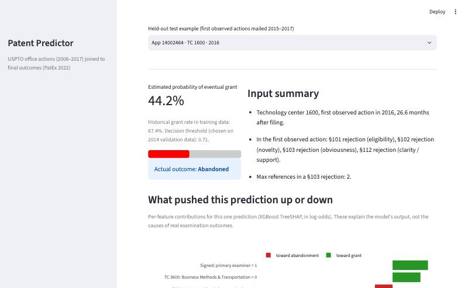
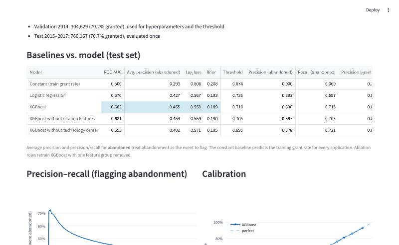

# Predicting Patent Grants from the First Observed Office Action

**Task.** On the day a U.S. utility patent application's **first observed office action** is mailed, estimate
the probability that the application is **eventually granted** (vs. abandoned). "First observed" means the earliest
action for that application in the Office Action dataset (actions mailed 2008–2017); see *Limits*.

**Data.** 2,167,535 applications whose first observed office action was mailed between March 2008 and July 2017,
joining two public USPTO datasets on application number:

| Source | Used for |
|---|---|
| [Office Action Research Dataset for Patents](https://www.uspto.gov/ip-policy/economic-research/research-datasets/office-action-research-dataset-patents), 2017 release, `office_actions` table (4,384,532 office actions, 2,188,039 applications) | Features: rejections, objections, allowable claims, and citation counts in the **first observed** action |
| [Patent Examination Research Dataset (PatEx)](https://www.uspto.gov/ip-policy/economic-research/research-datasets/patent-examination-research-dataset-public-pair), 2022 release, `application_data` table | Label (granted / abandoned), filing date |

**Result (test set, first observed actions mailed 2015–2017, 760,167 applications):** XGBoost reaches ROC-AUC
**0.683**, versus **0.670** for logistic regression and 0.5 for a constant baseline. Its probabilities are well
calibrated. The full comparison, slices, and error analysis are on the dashboard's *Model Evaluation* page and in `reports/`.

---

## Target definition

- `granted = 1` if the application has a patent number or a patented status in PatEx; `granted = 0` if its
  status is any form of abandonment. **1,981 applications still pending** in the 2022 data are excluded from
  training and evaluation and counted in `reports/dataset_summary.json`.
- Why not `allowed_claims`? In the Office Action dataset, `allowed_claims` = 1 when *that specific office action*
  indicates at least one allowable claim (USPTO variable tables, 2017 release). The dataset contains only rejection
  letters (non-final and final), not notices of allowance, so it cannot represent the final outcome. Here
  `allowed_claims` from the first observed action is used as a **feature**.

## Prediction moment and features

Every feature comes from the first observed office action or the application record on that day
(`utils/features.py`, shared by training and the app):

- **Action content:** §101 / §102 / §103 / §112 / double-patenting rejections, objections, allowable claims
- **Citations:** more than one §102 reference, more than three or exactly one §103 reference, max §103 references
- **Context:** technology center (from art unit), year mailed, months from filing, who signed the action

**Not used: applicant entity size.** PatEx's `small_entity_indicator` is the status as of the 2022 snapshot, not
at the time of the action. Proof: 7,612 actions mailed before 19 March 2013, when micro-entity status was created
by the AIA, are labeled `MICRO`. Using it would leak future information, so it was removed. (With it, test ROC-AUC
was 0.695.)

## Data preparation (`scripts/build_dataset.py`)

1. Parse `mail_dt` as a date **before** sorting; keep each application's earliest action (non-final before final on the same day).
2. Join to PatEx; keep utility applications; drop rows with invalid dates or art units outside the nine technology centers.
3. Label outcomes as above; write summary tables for the EDA page and a held-out example set for the app.

Row counts at every step: `reports/dataset_summary.json`.

## Evaluation design (`scripts/train_evaluate.py`)

| Split | First observed action years | Applications | Granted |
|---|---|---|---|
| Train | 2008–2013 | 1,102,739 | 67.4% |
| Validation | 2014 | 304,629 | 70.2% |
| Test | 2015–2017 | 760,167 | 70.7% |

- **Time-based split, no shuffling:** older applications train the model; newer ones evaluate it.
- **No resampling.** Models are fit on the real class balance, so probabilities remain interpretable.
- **Validation only** is used to choose XGBoost depth (early stopping and log loss) and the decision threshold
  (balanced accuracy). The test set is scored once.

## Results (test set)

| Model | ROC-AUC | Avg. precision (abandoned) | Log loss | Brier | Precision / recall (abandoned) |
|---|---|---|---|---|---|
| Constant (training grant rate) | 0.500 | 0.293 | 0.608 | 0.208 | n/a |
| Logistic regression | 0.670 | 0.427 | 0.567 | 0.193 | 0.392 / 0.697 |
| **XGBoost** | **0.683** | **0.455** | **0.559** | **0.189** | 0.396 / 0.715 |
| XGBoost without citation features | 0.681 | 0.454 | 0.559 | 0.190 | 0.397 / 0.703 |
| XGBoost without technology center | 0.655 | 0.402 | 0.571 | 0.195 | 0.378 / 0.721 |

Abandonment is 29.3% of the test set, so 0.293 is the chance level for average precision on abandonment.

**What the ablations say.** Removing the coarse citation flags barely changes performance (their signal overlaps
with the rejection flags). Removing technology center costs about 0.03 AUC, the largest drop of any group tested.

**Error analysis.** The most confident wrong "granted" predictions all had allowable claims in the first observed
action and were abandoned by failing to respond or failing to pay the issue fee. The examination record looked
favorable, but the applicant dropped it, which examination data cannot see. The lowest-scored applications that
were granted are chemical applications with very long §103 rejections (12–18 references) and business-method
applications that received §101, §102, §103, and §112 rejections together, and were pursued anyway. Ranking
quality is lowest in chemical and biotech (AUC about 0.64) and highest in business methods (about 0.72). See `reports/error_analysis.md` and `reports/slices_*.csv`.

**Limits.** Outcomes depend on applicant decisions (cost, strategy) that the features do not capture. The
earliest action in the dataset is not guaranteed to be the application's first-ever action: 28,437 applications
(1.3%) have a *final* rejection as their earliest observed action, which normally follows an earlier non-final one.
The data covers actions through mid-2017. The model describes historical patterns; it does not show that changing an
application would change its outcome.

## Dashboard

- **Predict:** load a held-out 2015–2017 example (with its actual outcome) or enter fields from a first observed action;
  shows the probability, an input summary, per-feature contributions for that prediction (XGBoost TreeSHAP), a
  what-if view of the *change in model prediction*, and global feature importance.
- **Model Evaluation:** baselines vs. model, precision–recall for flagging abandonment, calibration, confusion
  matrix, slices by technology center and year (with actual grant rates and counts), and the largest errors.
- **EDA Insights, Feature Glossary, About.**

| Predict (held-out 2016 example) | Model Evaluation |
|---|---|
|  |  |

## Reproducing the results

```bash
pip install -r requirements.txt          # on macOS, xgboost also needs: brew install libomp

# 1. download into data_raw/ (not committed):
#    office_actions.csv.zip   from the Office Action Research Dataset page (2017 release)
#    application_data.csv.zip from the PatEx page (2022 release)
#    and unzip both
python scripts/build_dataset.py          # about 1-2 minutes; writes data_raw/first_actions.parquet
python scripts/train_evaluate.py         # about 2-5 minutes; writes reports/ and models/
streamlit run app.py
```

The trained model (`models/xgb_model.json`) and all report files are committed, so the dashboard
runs without downloading the raw data.

## Repository structure

```
├── app.py                      prediction page
├── pages/                      evaluation, eda, glossary, about
├── utils/
│   ├── features.py             shared feature construction (training + app)
│   ├── model.py                model loading + scoring
│   └── header.py
├── scripts/
│   ├── build_dataset.py
│   └── train_evaluate.py
├── models/                     xgb_model.json, model_meta.json
├── reports/                    model comparison, slices, calibration, errors
├── data/                       EDA summaries + held-out examples
└── notebooks/patent_notebook.ipynb
```

## Changes from the first version

The original notebook applied SMOTE before the train/test split and evaluated on the resampled data, used
`allowed_claims` as if it were the final outcome, kept the last action of a random row sample after sorting dates
as text, and read only the first million rows of the file. Its reported metrics are not comparable to the results
above and should not be cited.
